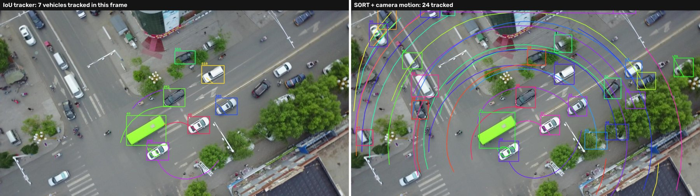

# Drone traffic counting: vehicle detection and tracking from UAV video

[](https://github.com/ankitsingathia/uav-vehicle-tracking/actions/workflows/tests.yml)

A traffic survey from a drone needs a count of how many vehicles passed. Counting needs tracking: the same car has to keep the same identity from the frame it appears to the frame it leaves. From the air this is hard:
- vehicles are 10–40 px wide and packed close together
- they disappear behind trees and each other
- the camera itself pans, climbs and drifts, so every parked car appears to move

This repo fine-tunes a YOLOv8n detector on VisDrone and writes three trackers from scratch: an IoU baseline, SORT with a Kalman filter, and ByteTrack-style association. It adds camera-motion compensation with OpenCV and measures each step on drone video the models never trained on. Every number comes from a script in this repo.

| Test-dev: 17 drone videos, 6,635 frames, never used for training or choices | Starting point: COCO detector + IoU tracker | **This repo: fine-tuned detector + SORT + camera motion** |
|---|---|---|
| MOTA | 0.231 | **0.633** |
| IDF1 (each vehicle keeps one identity) | 0.259 | **0.753** |
| Identity switches | 1,747 | **354** (−80%) |
| Vehicle count error, counting every track | 183% | 85% |
| Vehicle count error, counting tracks of 30+ frames (rule chosen on validation) | 56% | **24%** |

Where the gain comes from, each measured on its own:
- **Fine-tuning the detector on drone images.** Missed vehicles fall by 67% (92,420 → 30,954 boxes), and MOTA goes from 0.231 to 0.627 with the same IoU tracker.
- **Camera-motion compensation.** With SORT, identity switches fall by 67% (1,085 → 354) and IDF1 rises from 0.674 to 0.753.
- **Counting only tracks that last 30 frames.** The count error falls from 85% to 24%. A better detector also fires briefly on clutter, and each of those flickers becomes a short track.

---

## Data

[VisDrone2019](https://github.com/VisDrone/VisDrone-Dataset), drone footage from 14 Chinese cities, annotated by hand.

| Split | Used for | Size |
|---|---|---|
| DET train | fine-tuning the detector | 6,471 images, 188,623 vehicle boxes |
| DET val | detector validation during training | 548 images, 17,040 vehicle boxes |
| MOT val | comparing tracker designs | 7 sequences, 2,846 frames |
| MOT test-dev | the final numbers, scored once | 17 sequences, 6,635 frames |

Car, van, truck and bus are merged into one class, vehicle, because the task is a count. VisDrone's own benchmark scores five classes separately, so these numbers are not comparable to its leaderboard.

Annotators marked some very dense or distant areas as "ignored". As in VisDrone's own evaluation, tracker boxes that lie mostly inside them are dropped before scoring, so a correct detection there isn't counted as false.

## Method

1. **Detector.** YOLOv8n, COCO-pretrained, fine-tuned for 30 epochs on VisDrone-DET at 960 px on an RTX 3050 laptop GPU (4 GB). 960 rather than the default 640, because at 640 most vehicles shrink below what the network can resolve. The COCO model, keeping car, bus and truck, is the baseline.
2. **Detections are computed once and cached** (down to confidence 0.05), so every tracker is compared on identical boxes.
3. **Trackers** (`src/uavtrack/trackers.py`, about 250 lines):
   - **IoU tracker:** extends each track with the detection that overlaps it most. No motion model; a track ends at its first missed frame.
   - **SORT:** a constant-velocity Kalman filter per track (centre, area, aspect ratio and their rates) and Hungarian assignment on IoU between predicted and detected boxes.
   - **ByteSORT:** SORT plus ByteTrack's second pass. Tracks left unmatched by confident detections are matched against low-confidence ones, which is usually where a partly hidden vehicle is.
4. **Camera-motion compensation** (`src/uavtrack/camera_motion.py`): corners on the previous frame are followed with Lucas–Kanade optical flow, and a rotation, scale and translation is fitted with RANSAC. RANSAC rejects the points on moving vehicles. Every Kalman state (position, velocity and its uncertainty) is moved through that transform before predicting.
5. **Metrics** (`py-motmetrics`):
   - **MOTA:** misses, false positives and identity switches combined.
   - **IDF1:** how consistently each vehicle keeps one identity.
   - **ID switches.**
   - **Count error:** distinct track IDs against distinct real vehicles per sequence. This is what a survey would report, and MOTA hides it.

Tracker settings are the published SORT and ByteTrack defaults, fixed before any scoring and the same for every detector and split. See [DECISIONS.md](DECISIONS.md).

## Results



*The validation frame with the largest camera motion: a 164 px pan between two frames, on a sequence with 48 real vehicles. Same fine-tuned detections on both sides. Trails cover the previous 20 frames, each point drawn where the vehicle was in its own frame, so during a pan they sweep with the camera. The IoU tracker is following 7 vehicles at this moment, and its track IDs are already in the 500s because it keeps starting new tracks. SORT with camera-motion compensation is following 24.*

### Detector

YOLOv8n fine-tuned for 30 epochs at 960 px, 2.2 hours on the RTX 3050 laptop GPU. Scores on the 548 VisDrone-DET validation images, vehicle class:

| | mAP@0.5 | mAP@0.5:0.95 | Precision | Recall |
|---|---|---|---|---|
| After epoch 1 | 0.719 | 0.453 | 0.80 | 0.63 |
| After epoch 30 | **0.852** | **0.583** | 0.89 | 0.76 |

On the tracking videos it runs at 29 frames per second end to end on the GPU, including reading each image from disk.

### Trackers on validation (used to choose)

7 sequences, 2,846 frames, 40,286 vehicle boxes. Fine-tuned detector:

| Tracker | MOTA | IDF1 | ID switches | False positives | Misses | Count error (30+ frames) |
|---|---|---|---|---|---|---|
| IoU | 0.490 | 0.597 | 359 | 4,243 | 15,932 | 25.0% |
| SORT | 0.482 | 0.612 | 293 | 5,255 | 15,317 | 27.8% |
| **SORT + camera motion** | **0.503** | **0.683** | 101 | 5,559 | 14,367 | **15.8%** |
| ByteSORT | 0.403 | 0.584 | 295 | 9,976 | 13,769 | 59.9% |
| ByteSORT + camera motion | 0.403 | 0.665 | 95 | 11,743 | 12,210 | 39.3% |

SORT with camera motion and the 30-frame counting rule were chosen here, written into DECISIONS.md and committed before test-dev was run (`c3b4a59`).

### Trackers on test-dev (scored once)

17 sequences, 6,635 frames, 126,194 vehicle boxes:

| Detector + tracker | MOTA | IDF1 | ID switches | False positives | Misses | Count error (every ID) | Count error (30+ frames) |
|---|---|---|---|---|---|---|---|
| COCO + IoU | 0.231 | 0.259 | 1,747 | 2,882 | 92,420 | 183% | 56% |
| COCO + ByteSORT + camera motion | 0.384 | 0.576 | 179 | 14,915 | 62,625 | 29% | 37% |
| Fine-tuned + IoU | 0.627 | 0.644 | 1,475 | 14,632 | 30,954 | 269% | 35% |
| Fine-tuned + SORT | 0.626 | 0.674 | 1,085 | 17,550 | 28,623 | 147% | 34% |
| **Fine-tuned + SORT + camera motion** | **0.633** | **0.753** | 354 | 19,124 | 26,788 | 85% | **24%** |
| Fine-tuned + ByteSORT + camera motion | 0.554 | 0.730 | 383 | 35,872 | 20,059 | 73% | 31% |

All ten combinations are in `results/tracking_testdev.json`.

**What this shows:**

- **The detector matters most.** No tracker can follow a vehicle the detector doesn't see. With the COCO model, about three quarters of the ground-truth vehicle boxes are missed. Fine-tuning cut misses by two thirds.
- **Camera-motion compensation is the biggest tracker-side gain.** With a moving drone camera, a constant-velocity filter predicts in the wrong place whenever the camera pans. Moving every track with the camera cut identity switches by 45–67% in all four detector and tracker pairings (two thirds with the fine-tuned detector).
- **ByteTrack's second pass depends on the detector.** With the weak COCO detector, its low-confidence boxes are hidden vehicles worth keeping, and it is the best tracker there (MOTA 0.231 → 0.384). With the fine-tuned detector they are mostly clutter: false positives nearly double (19,124 → 35,872) and MOTA drops from 0.633 to 0.554. A published method's default settings are not neutral; they assume a detector.
- **MOTA hides the count.** Fine-tuned + IoU and fine-tuned + SORT + camera motion have nearly the same MOTA (0.627 vs 0.633). But the first splits vehicles into four times as many identity switches, and counting every ID over-counts by 269% against 85%. For a traffic survey, the count is the number that matters.
- **The counting rule works, with a cost.** Counting only tracks of 30+ frames brings the error to 24% on test-dev, against 15.8% on validation, where it was chosen. The bias is −6.7%: vehicles that cross the frame in under 30 frames are missed.

The trackers run at 780–4,000 frames per second in plain Python. Detection, not tracking, sets the speed.

### On a CPU: ONNX fp32 vs int8

A drone's onboard computer is closer to a laptop CPU than to a desktop GPU. The fine-tuned detector was exported to ONNX and quantised to int8 with ONNX Runtime. Calibration used 64 training images, never the validation sequences. Accuracy is judged by what matters downstream: the main tracker's results on the validation videos.

| Intel i5-12450H, 960 px input | fp32 | int8 (head in float) | int8 (whole model) |
|---|---|---|---|
| File size | 12.4 MB | 6.1 MB (−50%) | 3.5 MB |
| Time per frame, 1 thread | 244 ms | **176 ms** (1.39× faster) | — |
| Time per frame, 12 threads | 94 ms | **73 ms** (1.28× faster) | — |
| MOTA | 0.505 | **0.501** | **0.000** |
| IDF1 | 0.682 | 0.681 | 0.000 |
| Count error (30+ frames) | 12.5% | 15.2% | 86% |

**Quantising the whole model broke it.** YOLO's output tensor holds box coordinates (0–960 px) and confidence scores (0–1) side by side. A single int8 scale for both rounded every one of the 18,900 candidate scores to the same value, and the tracker received nothing. Keeping the detection head (66 of 233 graph nodes) in float fixed it: accuracy within 0.005 MOTA of fp32, at 1.3–1.4× the speed. The broken model was not timed fairly, since it is of no use.

The speed-up is modest. Likely reasons, not measured here: the float head and the conversions around it, and a model this small being limited more by memory traffic than by arithmetic. Neither model reaches real time on this CPU at 960 px; the GPU does, at 29 frames per second including disk reads. The first timing run was taken while the laptop was busy and gave the same fp32 model 219 ms and then 1,167 ms. The figures above come from `scripts/time_cpu.py`: both models timed back to back and alternated, median of 300 frames each.

## Run it

```bash
python -m venv .venv && .venv/Scripts/activate      # or source .venv/bin/activate
pip install torch==2.6.0 torchvision==0.21.0 --index-url https://download.pytorch.org/whl/cu124
pip install ultralytics motmetrics scipy pandas pytest onnx onnxruntime
python -m pytest -q                                   # 12 tests, no data or GPU needed
```

Data goes under `data/raw/`:
- `det_train.zip` and `det_val.zip` from the [Ultralytics VisDrone mirror](https://github.com/ultralytics/assets/releases/tag/v0.0.0)
- `mot_val.zip` and `mot_testdev.zip` from the [official VisDrone links](https://github.com/VisDrone/VisDrone-Dataset), unpacked to `data/raw/mot/val` and `data/raw/mot/testdev`

The Google Drive links hit their daily quota while this was built. The same zips, byte for byte the same size, are on [Hugging Face](https://huggingface.co/datasets/vanthanh/VisDrone2019-MOT); the sequence and frame counts were checked against the official ones before use.

```bash
python scripts/prepare_det.py                 # VisDrone-DET -> single-class YOLO labels
python scripts/train.py                       # about 2.5 h on an RTX 3050 laptop GPU
python scripts/cache_detections.py coco val   # and visdrone; val and testdev
python scripts/cache_warps.py val             # and testdev
python scripts/run_tracking.py val            # then testdev, once
python scripts/edge.py                        # ONNX fp32 vs int8: accuracy
python scripts/time_cpu.py                    # and fair CPU timing
python scripts/plot_tracks.py
```

Exact package versions are in `requirements.lock.txt`.

## Limits

- **One class.** Car, van, truck and bus are merged, so the scores are not comparable to VisDrone's five-class leaderboard.
- **The count is per sequence, not per counting line.** A real survey counts vehicles crossing a line or leaving a zone. The per-sequence count here is the closest thing the annotations allow.
- **The 30-frame rule misses fast crossers.** A vehicle seen in fewer than 30 frames is not counted, which is part of the −6.7% bias.
- **ByteSORT was run at its published defaults.** Its low-confidence threshold could be raised for a stronger detector. That would be tuning on validation, and it isn't done here.
- **Camera motion is a similarity transform.** At low altitude over tall buildings, the ground is not a plane, and a full homography or per-region motion would fit better.
- **The detector has not run on a drone's computer.** The int8 timing is on a laptop CPU, not on an embedded board.
